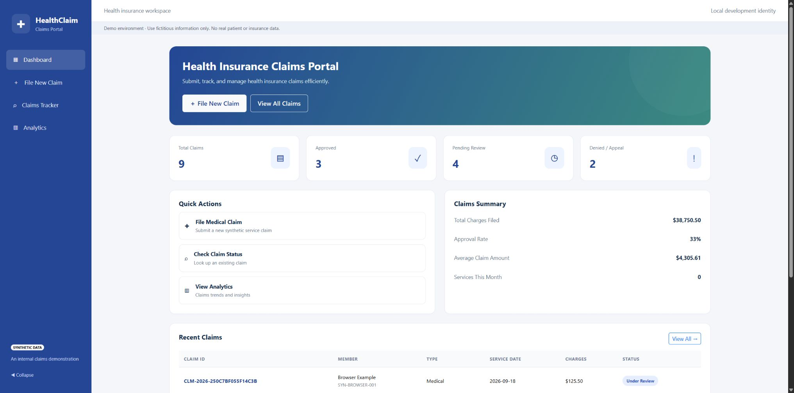

# Health Claims Portal

A standalone web app and REST API for **agentic AI demos**. Give an agent a realistic application to work with: create synthetic claims, look up their status, record reviewer updates, and summarize results.



## Start here

| Your goal | Starting point |
| --- | --- |
| Try the app quickly on your computer | [Run locally](docs/RUN-LOCALLY.md) |
| Deploy a demo in your Azure environment | [Deploy to Azure](docs/DEPLOYMENT.md) |
| Connect an agent to the claims API | [Agent integration](docs/API.md) |
| Learn how the code works | [Beginner's guide](docs/BEGINNERS_GUIDE.md) |
| Understand the components | [Architecture](docs/ARCHITECTURE.md) |

### Quick start with Docker

From the repository folder, with Docker Compose available:

```powershell
docker compose up --build
```

Open **http://127.0.0.1:8000**. The app starts with eight fictitious claims and a local demo identity. No cloud account or AI model is needed. See [Run locally](docs/RUN-LOCALLY.md) for the Python alternative, stopping the app, and preserving your data.

## Demo scenarios

- **Submit a claim:** an agent collects the required fields and creates a synthetic record.
- **Check progress:** an agent finds a claim and explains its current status and history.
- **Support a reviewer:** an authorized agent records a permitted status change and review note.
- **Summarize activity:** an agent reads aggregate claim counts and charge totals.

The browser supports the same workflows through a Dashboard, five-step claim form, Claims Tracker, and Analytics page. Agent-platform setup is separate: this repository supplies the application and API, not a preconfigured Copilot or Foundry agent.

## Three pieces, three jobs

| Piece | Technology | Job |
| --- | --- | --- |
| Application | Python/FastAPI + HTML, JavaScript, and Bootstrap | Screens, API, validation, and claim rules |
| Packaging | Docker | Runs the app consistently with its dependencies |
| Azure infrastructure | Bicep and GitHub Actions | Creates resources and deploys the app in your environment |

Local Python uses SQLite by default. Docker Compose and Azure use PostgreSQL. Azure deployments use Microsoft Entra authentication; local mode supplies a development identity.

## Scope and operating costs

**Use fictitious data only.** This app demonstrates workflows; it does not perform actual insurance adjudication, eligibility checks, payments, or clinical coding verification. It is not a production healthcare system.

Local instructions bind the app to localhost. Azure deployment creates billable resources. Review the [security and cost considerations](docs/DEPLOYMENT.md#operational-boundaries) before deploying.

## Reference guides

[API](docs/API.md) · [Entra setup](docs/AUTH.md) · [Deployment](docs/DEPLOYMENT.md) · [Testing your demo](docs/VALIDATION.md)

Building a Copilot Studio agent? Start with the [API and browser integration guide](docs/COPILOT_STUDIO.md) and its generated OpenAPI v2 definition.

Application tests and infrastructure checks run in GitHub CI. Azure deployment is a separate, manually triggered workflow. It defaults to **validation-only**; uncheck `dry_run` when you are ready to create Azure resources. See the [deployment sequence](docs/DEPLOYMENT.md).

## License and maintenance

[MIT license](LICENSE) · [Security guidance](SECURITY.md)

Dependency update pull requests cover Python packages, workflow actions, and Docker images. Review and run CI before merging. Browser libraries are vendored with licenses and an integrity manifest; update pinned versions in `scripts/vendor_assets.py`, regenerate the assets, and review their advisories separately.
