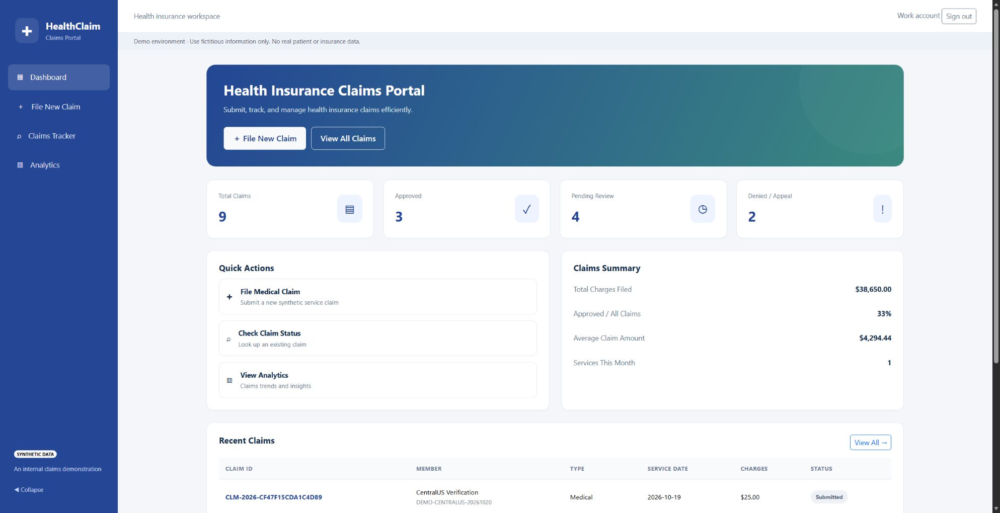

# Health Claims Portal

A web app and REST API for agentic AI demos. Submit synthetic claims, track their progress, record reviewer updates, and let an authorized agent work through the same API.



## Start here

| What you want to do | Guide |
| --- | --- |
| Try the app on your computer | [Run locally](docs/RUN-LOCALLY.md) |
| Set up identities, GitHub, and Azure | [Automated onboarding](docs/DEPLOYMENT.md#automated-onboarding) |
| Connect an agent | [API](docs/API.md) · [Copilot Studio](docs/COPILOT_STUDIO.md) |
| Understand the solution | [Architecture](docs/ARCHITECTURE.md) · [Beginner's guide](docs/BEGINNERS_GUIDE.md) |
| Check your deployment | [Validation](docs/VALIDATION.md) |

## Run locally

With Docker Compose installed, run this from the repository folder:

```powershell
docker compose up --build
```

Open **http://127.0.0.1:8000**. The app loads eight fictitious claims and a local demo identity. No Azure account or AI model is required. The [local guide](docs/RUN-LOCALLY.md) also covers Python and saved data.

## Zava deployment

The **zavaclaims** demo runs in **Central US**: Linux App Service B1, private PostgreSQL 16, Container Registry, runtime identity, and Log Analytics. One VNet and private DNS connect the app and database in `rg-health-claims-portal-demo`.

[Open the Zava portal](https://zavaclaims-portal.azurewebsites.net/) with an assigned Zava work account. Sign-in, synthetic claim submission, and persistence after reload were verified on October 20, 2026.

For your own tenant, the [onboarding command](docs/DEPLOYMENT.md#automated-onboarding) creates the three Entra registrations, permissions, GitHub OIDC connection, environment settings, and database secrets. With `--deploy`, it also deploys the app and sets the SPA redirect URL. Initial administrator sign-ins are required; Azure capacity and tenant policies still apply.

## What the app does

- **File claims:** use the five-step browser form or submit through the API.
- **Track progress:** search claims and read their details and history.
- **Review claims:** record an allowed status change with a review note.
- **Read analytics:** view claim counts and charge totals.

FastAPI handles authorization, input checks, and claim rules. HTML, JavaScript, and Bootstrap provide the screens. Docker packages the app; Bicep and GitHub Actions deploy it. Python local mode uses SQLite by default; Compose and Azure use PostgreSQL. Azure sign-in uses Microsoft Entra.

The repository provides the app and API. Configure and test your Copilot Studio or Foundry agent separately.

The optional [Medical Claims Concierge connection](docs/CLAIMS_CONCIERGE.md) applies verified human decisions to explicitly allowed fictional claims through a protected Dataverse queue.

## Scope and maintenance

**Use fictitious data only.** This is a shared demo workspace. It does not perform insurance adjudication, eligibility checks, payments, or clinical coding verification.

Azure resources incur charges, including while the demo is idle. Read the [deployment boundaries](docs/DEPLOYMENT.md#operational-boundaries) and [security guidance](SECURITY.md) before sharing it.

CI checks the application, API contracts, infrastructure, and container. Later Azure releases use the manual **Deploy Azure demo** workflow, which defaults to validation only. Review dependency updates before merging. Browser libraries are vendored with licenses and an integrity manifest; update them through `scripts/vendor_assets.py`.

[MIT license](LICENSE) · [Entra configuration](docs/AUTH.md)
