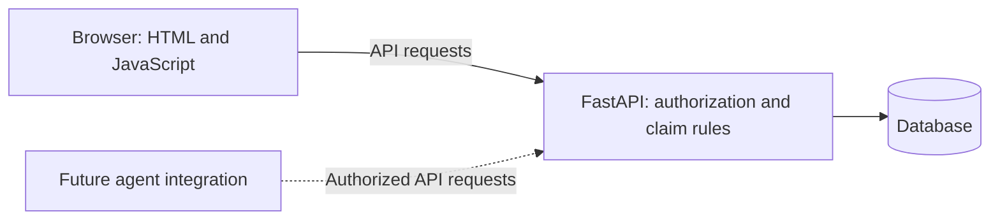
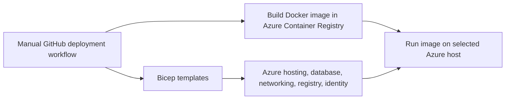

# How the application fits together

[Back to the README](../README.md) · [Beginner's guide](BEGINNERS_GUIDE.md)

## When someone uses the app

FastAPI serves both the browser files and the REST API from one application. Claim rules live in Python; the browser presents the forms and results. The database preserves records between requests and restarts, provided its file or storage volume is retained.

| Environment | Database | Identity | Hosting |
| --- | --- | --- | --- |
| Local PowerShell script | SQLite file by default | Built-in development identity | Your computer, localhost only |
| Local Docker Compose | PostgreSQL with a named volume | Built-in development identity | Containers on your computer |
| Azure | Private PostgreSQL Flexible Server | Microsoft Entra | App Service or Container Apps |

Choose App Service or Container Apps for your Azure deployment. Both options run the same application and claim rules.

## When someone deploys the app

- [foundation.bicep](../infra/foundation.bicep) defines shared resources such as networking, PostgreSQL, the registry, and runtime identity.
- [app-service.bicep](../infra/app-service.bicep) configures App Service hosting.
- [app.bicep](../infra/app.bicep) configures the alternative Container Apps host.
- [deploy.yml](../.github/workflows/deploy.yml) coordinates provisioning, image building, deployment, and a readiness check.

**Bicep creates infrastructure; Python implements application behavior; Docker packages the application.** GitHub's validation workflow tests changes. The separate deployment workflow runs only when explicitly triggered.

## What is portable?

The application logic does not depend on Azure SDKs. Docker and PostgreSQL can run elsewhere. Bicep and the supplied deployment workflow target Azure public cloud. Entra is the selected identity provider; replacing it requires changes to token verification and browser sign-in.

A new Azure environment still needs its own identities, permissions, configuration, available capacity, and compatible policies. Portability does not bypass those requirements.

## Current design boundaries

Database migrations run at startup using a separate administrator connection, with a PostgreSQL advisory lock to serialize cooperating startup processes. The API then runs with a restricted database user; see [Deployment](DEPLOYMENT.md) for credential and restart behavior. Demo seeding is optional in that startup path. This keeps the small demo convenient; controlled release migrations are preferable for larger deployments.

The claim table stores structured fields plus JSON payload and history. That supports this demonstration; it is not an immutable enterprise audit system.

Structured console logs and modest per-instance request limits are included. The repository does not configure a complete production monitoring, distributed abuse-protection, or disaster-recovery solution. See [deployment caveats](DEPLOYMENT.md#operational-boundaries) and [demo checks](VALIDATION.md) before expanding its use. Future Copilot/Foundry integration is an intended extension, not a completed component.
