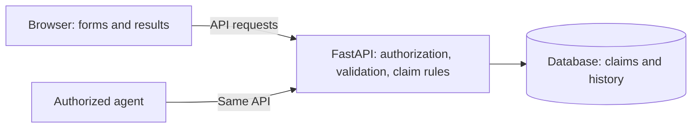
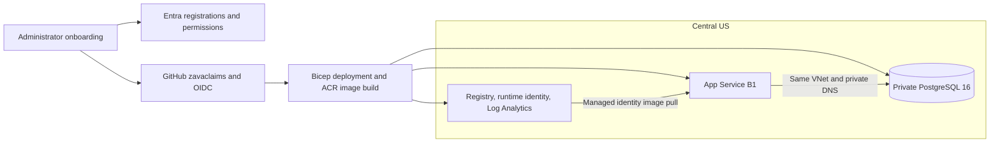

# How the application fits together

[Back to the README](../README.md) · [Beginner's guide](BEGINNERS_GUIDE.md)

## Application flow

FastAPI serves both the browser files and REST API. Python owns the claim rules; the browser gathers input and displays results. Agents use the same authorized endpoints. Agent-platform connections are configured separately.

| Environment | Database | Identity | Host |
| --- | --- | --- | --- |
| Local PowerShell | SQLite file by default | Development identity | Localhost |
| Docker Compose | PostgreSQL named volume | Development identity | Local containers |
| Zava Azure demo | Private PostgreSQL 16, Central US | Microsoft Entra | App Service B1, Central US |

The database file or volume must be retained for local data to survive restarts. Azure stores claims in PostgreSQL independently of the app container.

## Azure deployment

The verified Zava profile keeps all regional services in Central US, in `rg-health-claims-portal-demo`. A single VNet has separate database and web subnets; no cross-region peering is required. [Onboarding](DEPLOYMENT.md#automated-onboarding) creates the identities and GitHub settings, runs validation/deployment, then uses the administrator session to set the SPA redirect URL.

| Source | Responsibility |
| --- | --- |
| [onboard_azure.py](../scripts/onboard_azure.py) | Administrator setup, OIDC discovery, workflow execution, redirect |
| [foundation.bicep](../infra/foundation.bicep) | Database, registry, identity, logs, networking, optional cross-region peering |
| [app-service.bicep](../infra/app-service.bicep) | App Service plan and container configuration |
| [app.bicep](../infra/app.bicep) | Alternative Container Apps hosting |
| [deploy.yml](../.github/workflows/deploy.yml) | Preflight, provisioning, image build, deployment, readiness |

Both Azure hosts run the same application. GitHub deploys only when triggered by an operator or onboarding; CI validates changes separately.

## Design choices and limits

- **Separate setup and runtime permissions.** Startup uses an administrator connection for migrations and optional seeding, serialized with a PostgreSQL advisory lock. The API then uses a restricted database account. Bootstrap credentials stay in hosting settings for later starts; see [deployment boundaries](DEPLOYMENT.md#operational-boundaries).
- **Keep the demo portable.** Application logic has no Azure SDK dependency. Docker/PostgreSQL can run elsewhere; the supplied Bicep and workflows target Azure public cloud. Replacing Entra requires changes to token validation and browser sign-in.
- **Keep history with the claim.** Structured columns plus JSON payload/history support the demo. They are not an immutable enterprise audit system.
- **Match controls to the scope.** Request limits and JSON events are included. Production monitoring, distributed abuse protection, load testing, and recovery exercises need separate work.

A new tenant still needs administrator authorization, available capacity, and compatible policies. [Validation](VALIDATION.md) distinguishes automated checks from verified live behavior.
